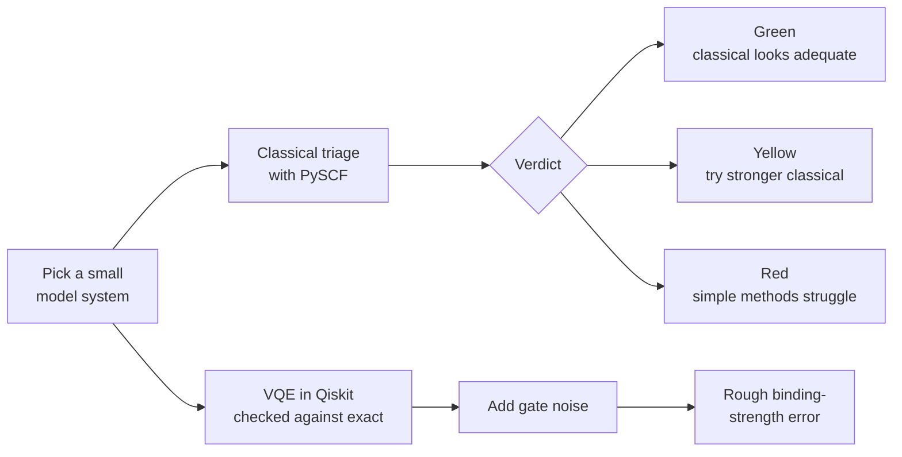

<p align="center">
  
</p>

<h1 align="center">TriageQ</h1>

<p align="center">
  <strong>A traffic light for quantum chemistry.</strong><br>
  Flag where simple methods struggle, test the case with VQE, and see what qubit noise does to the answer.
</p>

<p align="center">
  
  
  
  
</p>

---

## The question

Most quantum demos ask, *"Can quantum simulate this molecule?"*

TriageQ asks a more useful one: ***"Is a quantum method even worth trying here?"***

## How it works



| Step | What happens | Tool |
| --- | --- | --- |
| **1. Triage** | Scores how strongly correlated the electrons are | PySCF |
| **2. Simulate** | Runs VQE and compares it with the exact answer | Qiskit, Qiskit Nature |
| **3. Stress-test** | Reruns the circuit under simulated noise | Qiskit Aer |
| **4. Translate** | Turns energy error into a rough binding-strength error | Python, Streamlit |

## What we found

| System | Verdict | Correlation score | Hartree-Fock error (kcal/mol) | Qubits |
| --- | --- | --- | --- | --- |
| H2, normal bond | 🟢 Green | 0.025 | 12.9 | 4 |
| H2, stretched bond | 🔴 Red | 0.811 | 146.3 | 4 |
| LiH | 🟢 Green | 0.001 | 0.2 | 4 |
| Ethylene, planar | 🟡 Yellow | 0.126 | 28.0 | 4 |
| Ethylene, twisted | 🔴 Red | 1.000 | 78.0 | 4 |
| Water, normal | 🟢 Green | 0.008 | 4.7 | 8 |
| Water, stretched | 🔴 Red | 0.558 | 202.9 | 8 |

- **VQE works in simulation:** it matched the exact answer to within 0.1 kcal/mol for H2, LiH and planar ethylene.
- **Noise hurts quickly:** at 0.01% two-qubit gate error, normal H2 is off by about 3 kcal/mol, or roughly 150x in binding strength.
- **Red doesn't mean quantum wins:** twisted ethylene gave unstable VQE results, so TriageQ only shows its triage verdict.

## Quick start

Tested on Linux with Python 3.13. On Windows, use WSL, since PySCF doesn't support Windows natively.

```bash
git clone https://github.com/IshaanMittal07/TriageQ.git
cd TriageQ
python -m venv .venv
source .venv/bin/activate
pip install -r requirements.txt pytest

python precompute.py     # about 1-2 minutes; refreshes results.json
pytest -q                # optional, about 1-2 minutes
streamlit run app.py
```

To try the circuit on a simulated IBM device, with no account needed:

```bash
python hardware.py
```

To use a real IBM device, [set up your account](https://quantum.cloud.ibm.com/docs/en/guides/cloud-setup) and run `python hardware.py --real`. That path hasn't been tested yet.

## Project layout

```text
app.py          Streamlit demo
molecules.py    The model systems
triage.py       Classical scoring and verdicts
quantum.py      VQE, noise and binding translation
precompute.py   Generates results.json
hardware.py     Fake or real IBM backend run
assets/         Project icon
```

## Read this before you quote us

- **These are tiny model systems, not real drugs.** TriageQ is not a drug discovery or medical tool.
- **There's no quantum advantage here.** A classical computer solves every case exactly, and that's how we check VQE.
- **The verdict cut-offs are demo choices.** The 0.10 and 0.50 thresholds haven't been validated.
- **The binding figure is a rough illustration.** It uses about 1.364 kcal/mol per 10x at 298 K, but real binding also depends on solvent, protein motion and entropy.
- **The noise model is simple.** It uses depolarizing noise, not a full model of a real device.

## What's next

- Validate the verdict cut-offs on a published benchmark set
- Run the circuit on real IBM hardware and compare it with the simulations
- Add error mitigation and measure how much it helps
- Show how qubit needs grow with larger active spaces

## Author

Built by [Ishaan Mittal](https://github.com/IshaanMittal07).

---

<p align="center">Built with curiosity, and an exact answer to check our work.</p>
